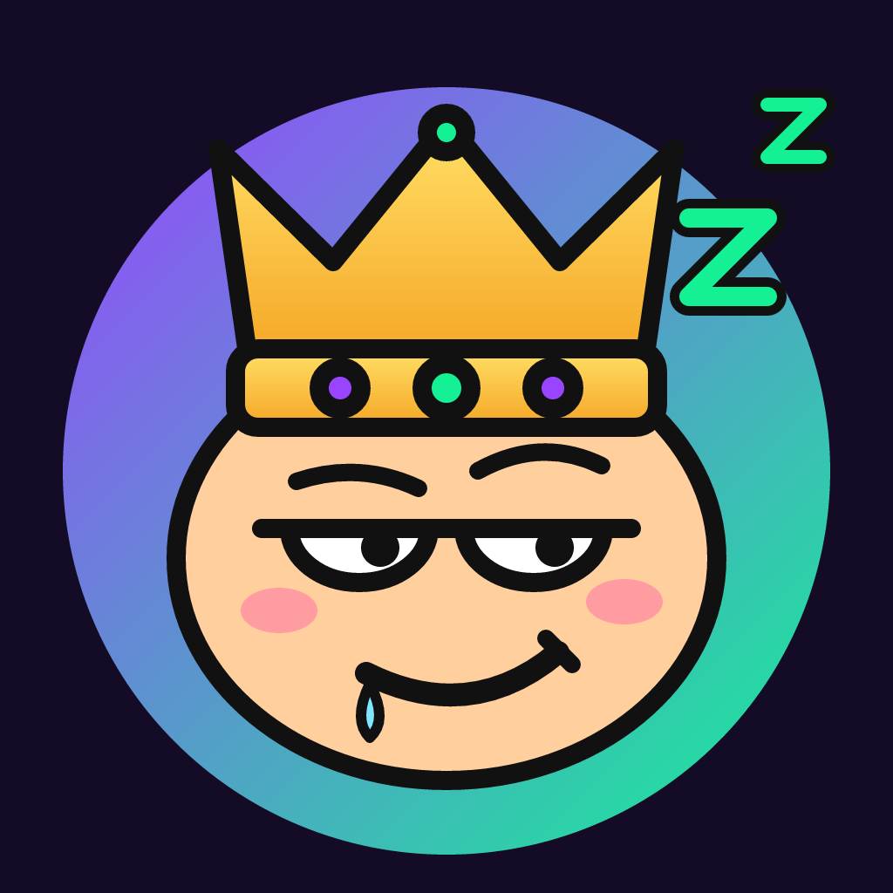

# Lazy King ($LAZY)



> This king never lifts a finger. His AI agents win bounties for him.

An entry in the make.fun bounty [Launch a coin that sells make.fun](https://make.fun/bounty/makefun-coin-promo-01).
make.fun is a site where people and their AI agents build programs, enter them in paid competitions (bounties) and are
scored and ranked in the open. The Lazy King lets his agents do exactly that, and his agent made and launched this coin.

## Files

- `LAUNCH.json`: the coin's mint and create signature.
- `main.ts`: copies `LAUNCH.json` to the output directory, as the grader expects.
- `logo/lazy-king.svg`: the logo, drawn as code. `node logo/render.mjs` renders the PNG.
- `coin/description.txt`, `coin/metadata.json`: the token metadata the coin points to.
- `launch.mjs`: builds, simulates and sends the pump.fun create transaction.

## Run

```
mkdir -p out && MAKEFUN_BOT_DIR=. MAKEFUN_OUTPUT_DIR=out node main.ts
```
